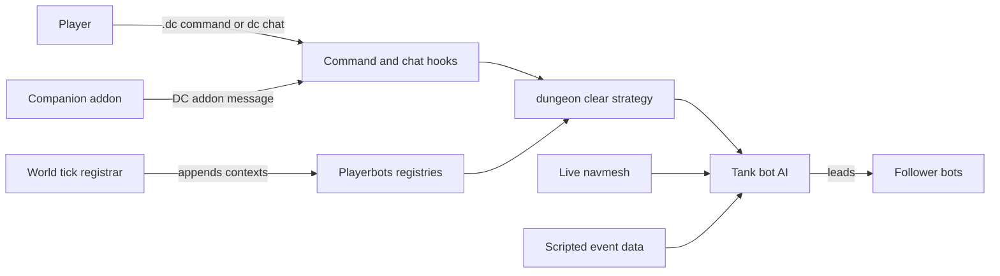

# mod-dungeon-clear

An AzerothCore module that lets a mod-playerbots tank bot clear a dungeon on its own.

A tank bot drives the party from boss to boss: it clears trash, paths the
layout, pauses for loot, rests between fights, and handles doors and scripted
events along the way. It is for players who run dungeons with playerbots
parties: you deal damage and let the tank run the dungeon.

## What it does

While enabled, the tank bot handles a run end to end:

- **Routing** from boss to boss over the live navmesh, including long corridors,
  doors, and multi-wing maps.
- **Pulling trash** on the way to each boss, with selectable pull styles (see
  [Pull modes](#pull-modes)).
- **Scripted events** that gate progress in many classic and Burning Crusade
  dungeons: levers, altars, gongs, freed prisoners, escorts, wave set-pieces,
  and off-mesh drops (see [Scripted dungeon events](#scripted-dungeon-events)).
- **Looting** finished corpses, with a quality floor and skip logic so the party
  does not camp on corpses with nothing worth taking.
- **Resting** between fights, tracking playerbots' own eat and drink thresholds.
- **Party support**: followers stay with the tank, healers reposition to keep the
  tank in line of sight, and the group regroups after a fight pulls it apart.
- **Death recovery**: when a member dies and a living Priest, Paladin, Shaman, or
  Druid remains, the run holds while they resurrect the fallen and resumes once
  everyone is back up, instead of ending on the first death (`DungeonClear.PostCombatRez`).
  The run still ends on a full wipe, with no living resurrector, or on timeout.

**Heroic difficulty** is supported: the tank pulls more carefully, several
settings carry their own heroic values, and a few events fire only on heroic.
See [Configuration](#configuration).

## Quick start

You need an AzerothCore source tree with **mod-playerbots** installed and
enabled. This module is an extension of the playerbots AI engine: it
subclasses playerbots' strategy, action, trigger, and value classes and links
against them. It is not standalone.

1. Clone into `modules/mod-dungeon-clear/` of that tree.
2. Re-run CMake and rebuild the worldserver (`-DMODULES=static`).
3. Optionally copy `conf/mod_dungeon_clear.conf.dist` to
   `mod_dungeon_clear.conf`.
4. In a dungeon, in a party whose tank is a bot, type `.dc on`.

[**mod-dungeon-clear-addon**](https://github.com/jrad7/mod-dungeon-clear-addon)
is the recommended way to drive a clear: a movable in-game panel with On, Off,
Skip, and Pause buttons, a live status readout, a per-boss list, and a settings
panel for live tuning. The `dc` chat keywords and `.dc` commands still work, but
the addon is easier to use. See [Usage](#usage) for every command.

## How it works



mod-playerbots exposes no extension API, so on the first world tick a
registrar appends this module's strategy, action, trigger, and value contexts
into every class's shared playerbots registries, and a login hook applies the
`dungeon clear` strategy to bots. The `.dc` command, the in-party `dc` chat
keywords, and the companion addon's `DC` addon messages all dispatch to the
same tank-bot actions.

The tank bot routes over the live navigation mesh, with no waypoints or
hardcoded paths; the hand-built data the module carries is for scripted events
and known navmesh breaks, not for routing. Follower bots stay with the tank
while the clear is on. It runs against a stock, unmodified mod-playerbots
checkout and touches no playerbots file. Details:
[How it integrates](https://github.com/jrad7/mod-dungeon-clear/wiki/How-It-Integrates).

## Run and test locally

The pull request checks in `.github/workflows/tests.yml` run three build-free
lints, then build and run the gtest suite. The lints run from this module's
root:

```sh
bash tools/check_determinism.sh
python3 tools/check_config_reads.py
python3 tools/check_msvc_portability.py
```

The suite links the full core `game` library, so it builds inside a complete
tree: the playerbots core fork (`mod-playerbots/azerothcore-wotlk`) at the
root, with mod-playerbots and this module under `modules/`. CI pins the core
and mod-playerbots commits in the workflow's job matrix. From the core root:

```sh
CC=clang CXX=clang++ cmake -B build \
  -DCMAKE_BUILD_TYPE=RelWithDebInfo -DBUILD_TESTING=ON \
  -DSCRIPTS=static -DMODULES=static -DNOPCH=1
cmake --build build --target dungeon_clear_tests -j"$(nproc)"
cd build && ./dungeon_clear_tests \
  --gtest_filter='*DungeonClear*:Dc*:RoomAggro*:BossRoster*:DungeonEvent*:EventBuilder*'
```

CI adds ccache and the mold linker to the configure step; neither changes
what is tested. `t/run_tests.sh` is a local shortcut for the same build and
run with a wider filter. The navmesh suites skip themselves when no map data
is present; CI restores an optional private slice into `t/fixtures/mapdata`.

A pull request that touches `testdeck/` also runs the Test Deck suite
(`.github/workflows/testdeck.yml`). From `testdeck/`:

```sh
python -m pip install -e ".[dev]"
python -m py_compile launch.py
python -m pytest t -q
cd web && npm ci && npm run build && cd .. && node t/web_smoke.mjs
```

`bash testdeck/t/run_tests.sh` runs the same steps in one go.

## Configuration

All `DungeonClear.*` options live in `conf/mod_dungeon_clear.conf.dist`, and most
are overridable live, per run, from the companion addon's Settings panel. Common
ones: loot quality floor, rest health and mana targets, and the Dynamic pull
tuning. See the
[Configuration reference](https://github.com/jrad7/mod-dungeon-clear/wiki/Configuration)
wiki page.

Any setting can be given a **heroic-difficulty value** by appending `.Heroic` to
its name (`DungeonClear.PullDynamicMaxLeeroyMobs.Heroic = 2`), which applies
while the run is inside a dungeon at heroic difficulty. Several options ship
with a heroic default that differs from the normal one; the conf lists them, and
`.dc config` marks them with an `H`. Resolution order is per-run override ->
`<key>.Heroic` -> `<key>` -> built-in default.

A few mod-playerbots ranges also affect runs (`LootDistance`, `ReactDistance`,
`SightDistance`, `FollowDistance`). The rest gate tracks playerbots' own eat and
drink thresholds automatically, so no playerbots config change is required.

The Test Deck reads its settings from a copy of
`testdeck/testdeck.example.toml`.

Not shipped with this repository: the AzerothCore server with mod-playerbots,
its databases and map data, a game client, and the companion addon.

## Status

Open work is tracked in the goal issue
[Every guild run clears its dungeon without a stall](https://github.com/quadseven/mod-dungeon-clear/issues/22).

## Contributing

Changes land through a pull request against the default branch,
`quadseven/prod`. A merge needs the review bot's `Grug - Chief` and
`Grug - Elder` checks to pass on the pull request's head commit; the
`tests.yml` lints and gtest suite, and `testdeck.yml` for `testdeck/`
changes, run on every pull request too. Read
[AGENTS.md](https://github.com/quadseven/infra-public/blob/main/templates/public-repo/AGENTS.md),
the rules for every public quadseven repository, first: this repository is
public.

## Usage

Both input methods control the same behaviour and act on the group's **tank**
bot. They must come from a real player in the bot's group, and `.dc on` requires
being inside a dungeon. (`.dc spectate` is the exception: it acts on your own
session, so it needs no group.)

| Slash command | In-party chat keyword | What it does |
|---|---|---|
| `.dc on` | `dc on` / `dungeon clear on` | Start the clear. |
| `.dc off` | `dc off` / `dungeon clear off` | Stop and return bots to the player. |
| `.dc pause` | `dc pause` / `dungeon clear pause` | Soft-stop in place; resume with the same command. |
| `.dc skip` | `dc skip` | Skip the current objective if the tank is stalled. |
| `.dc pull` | `dc pull` / `dungeon clear pull` | Cycle the pull mode. |
| `.dc status` | `dc status` | Print the current run status. |
| `.dc bosses` | `dc bosses` | List the dungeon's bosses and kill state. |
| `.dc go <boss>` | | Route directly to a named boss. |
| `.dc config` | | Print the effective `DungeonClear.*` values for the current run, marking addon overrides and heroic defaults. |
| `.dc spectate` | | Toggle the free-fly spectator camera. `.dc spectate follow [name]` rides a bot instead. |

There is also `.dc test`, a GM-only automated test harness; see
[Automated test runs](#automated-test-runs), below.

Non-tank party bots follow the tank only while it has dungeon clear enabled, then
revert to the player automatically.

## Pull modes

How the tank takes trash packs on the way to each boss. Choose from the addon's
pull control or the `dc pull` toggle.

| Mode | Behaviour | Speed | Risk |
|---|---|---|---|
| **Dynamic** *(recommended)* | Decide per pack: Leeroy a lone pack, camp-pull a clustered or oversized one. | Middle | Middle |
| **Leeroy** | Walk straight into each pack and fight in place. | Fastest | Highest |
| **Advanced** | Pull every pack back to a held camp before fighting. | Slowest | Lowest |

**Dynamic suits most content.** It Leeroys easy packs at full speed and only pays
the careful camp-pull cost on dangerous ones, estimating how many mobs would
actually aggro and comparing that to a tunable ceiling
(`DungeonClear.PullDynamicMaxLeeroyMobs`). Use **Leeroy** in content you can
out-gear, or **Advanced** in harder content where every pull matters.

See the [Pull modes](https://github.com/jrad7/mod-dungeon-clear/wiki/Pull-Modes)
wiki page for how each mode works in detail and how to tune Dynamic.

## Scripted dungeon events

Many instances gate progress behind a scripted step the party must perform: pull
a lever, click a panel, ring a gong, free a prisoner, escort an NPC, survive a
wave set-piece, or cross a break in the navmesh. mod-dungeon-clear performs
these automatically as part of the normal boss route, with no player input.

Event support currently covers, in classic: Deadmines, Shadowfang Keep, Wailing
Caverns, Uldaman, Sunken Temple, Razorfen Downs, Scarlet Monastery, Zul'Farrak,
Blackrock Depths, Scholomance, Stratholme, and Dire Maul; and in Burning
Crusade: Hellfire Ramparts, Blood Furnace, Shattered Halls, Slave Pens,
Underbog, Steamvault, Sethekk Halls, Mechanar, Arcatraz, Black Morass, Old
Hillsbrad, and Magisters' Terrace; and in Wrath of the Lich King: Utgarde Keep,
the Nexus, Azjol-Nerub, Ahn'kahet, Drak'Tharon Keep, the Violet Hold, Gundrak,
Halls of Stone, Halls of Lightning, Utgarde Pinnacle, the Culling of Stratholme,
Trial of the Champion, Pit of Saron, and Halls of Reflection. Coverage continues
to expand. (Trial of the Champion's joust itself is fought by mod-playerbots'
`wotlk-toc` strategy; mod-dungeon-clear musters the mounted party and starts
each phase.)

Faction-specific events run only for the relevant side, and heroic-only events
never fire on a normal run. If an event cannot complete (for example, a scripted
NPC the party let die), the run either stalls for the player or skips the step,
depending on whether the step is required.

The full per-dungeon list is on the
[Scripted Dungeon Events](https://github.com/jrad7/mod-dungeon-clear/wiki/Scripted-Dungeon-Events)
wiki page.

## You cannot play *as* the tank with dungeon clear on

Dungeon clear drives the **tank bot's** AI, so the tank must be a bot. If you
personally control the tank, the AI and you fight over the same character. The
exception is **self-bot mode**: turn your own character into a self-bot
(`.playerbots bot self`) and let the AI drive. If you want hands on the keyboard,
play a follower instead.

## Automated test runs

`.dc test` is a **GM-only** harness, not part of normal play. One command rolls
a random 5-bot party (tank, healer, three DPS on five different classes), levels
and gears it, sends it to a dungeon entrance and lets it clear the place on its
own. You stay out of the party and watch, or `.dc test watch` the camera along.
Every run records its seed, so a run that hits a bug can be replayed with the
exact same party, and `.dc test plan` runs the same dungeon N times to give you
a success *rate* rather than an anecdote.

**[Test Runs](https://github.com/jrad7/mod-dungeon-clear/wiki/Test-Runs)**: the
full command reference, gear and party options, plans, watching, the headless
test-driver character, and where the results are written.

**[Test Deck](https://github.com/jrad7/mod-dungeon-clear/wiki/Test-Deck)**: the
web frontend for those runs, shipped in `testdeck/`. Log in with a game GM
account, pick a dungeon from a grid, and watch the party live; built to be
handed to testers without shell access.

## License

AGPL-3.0-or-later (inherited from mod-playerbots). See `LICENSE`.
